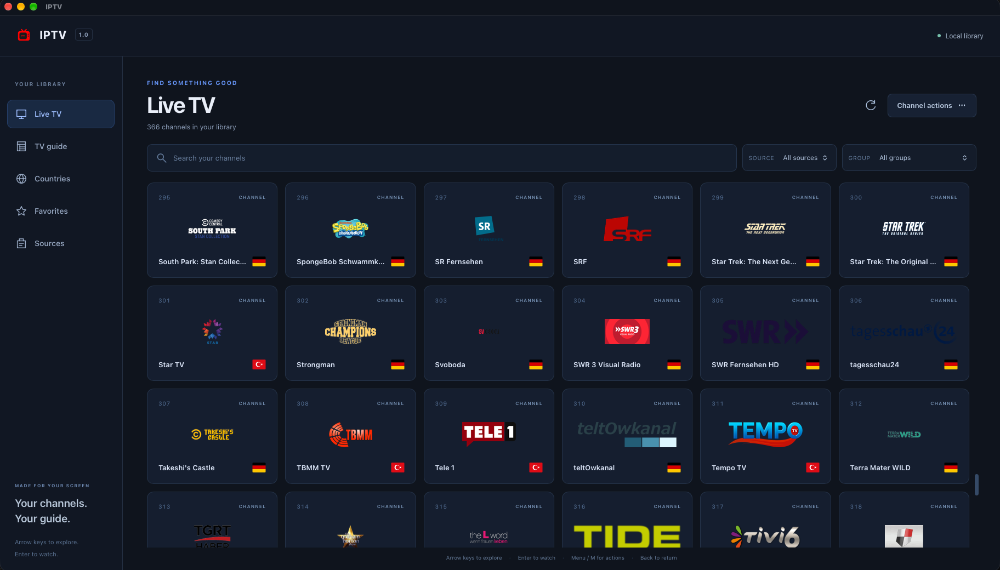

# IPTV



A unified Ionic React / Tauri 2 application for live TV: bring your own M3U playlists and XMLTV guides, or build a library from the public [iptv-org](https://github.com/iptv-org/iptv) datasets. Catalogue processing, persistence, credentials, network policy, artwork and playback authorization belong to Rust; the UI owns presentation and remote interaction. Desktop and Android/Fire TV share one code base.

> **Delivery status:** verified source, not a certified release. The dependency graph is committed and pinned; type checking, linting, the Rust, frontend, SQL, tooling and browser suites, native builds on Linux, macOS and Windows and the live relay checks pass, and the release workflow builds and Sigstore-signs Linux, Windows, macOS and Android packages. Operating-system signing (Apple notarization, Windows Authenticode, Android release keys), installation on Fire OS devices and native playback of every stream type have not been verified. Read [verification](docs/VERIFICATION.md) and [compatibility](docs/COMPATIBILITY.md) before release.

## What it does

- **Two source kinds.** An own M3U playlist, optionally with up to four XMLTV guides, a default country and an exact CDN host allowlist. Or an iptv-org source: either the official prebuilt playlists (countries with `GB` mapped to the published `UK`, categories, languages, regions, subdivisions, cities, upstream sources and master indexes) or a custom selection computed locally from the public datasets with origin, direct-coverage or regional country modes, category and language filters, and blocklist, NSFW, closed-channel and label exclusions. Both kinds share the catalogue, countries, groups, favorites, guide and player.
- **Local library.** Imports stream through bounded parsers into staged SQLite generations that activate atomically; a failed refresh keeps the last good catalogue. Channel artwork is fetched through a bounded image policy, cached privately and served to the UI over the loopback relay, so no remote image URL reaches the WebView.
- **Playback.** Rust authorizes one session at a time and relays HLS, DASH, MPEG-TS, FLV and progressive streams over loopback with rewritten manifests; media bytes and provider headers never cross the WebView. Desktop plays through native HLS, hls.js, dash.js or mpegts.js; Android uses a native Media3 player. A stream that fails before its first frame falls back to the next variant automatically, and failures are reported as codec, format or connection problems rather than one generic message.
- **Built for the remote.** D-pad navigation with logical focus, an icon toolbar over the video that hides itself after a few seconds, fullscreen that shows only the picture, media keys, and Back that leaves a text field before it navigates.

## Security in one paragraph

Source URLs, headers and stream secrets are sealed with XChaCha20-Poly1305 under a random per-profile key that Rust creates on first start and keeps in a private file beside the data; there is no passphrase and nothing to unlock. Every upstream request passes the Rust network policy: HTTPS unless the source consents to HTTP, DNS pinning, loopback, private, link-local and metadata address blocks, re-checked redirects, and an exact host allowlist for own playlists (public hosts only for aggregator sources). Unverified certificates are an explicit per-source consent, treated like cleartext. The WebView receives loopback URLs only and no shell, filesystem, SQL or HTTP plugin authority. Details are in [SECURITY.md](docs/SECURITY.md).

## Installing a release

[Releases](https://github.com/devsolux/iptv/releases) carry Linux, Windows, macOS and Android packages, a `SHA256SUMS` manifest and a keyless Sigstore bundle for every file. No operating-system vendor has signed them, so verify a download before you trust it (Cosign 3):

```sh
cosign verify-blob --bundle IPTV-1.0.0-macos-universal.dmg.sigstore.json \
  --certificate-identity-regexp '^https://github\.com/devsolux/iptv/\.github/workflows/releases\.yml@' \
  --certificate-oidc-issuer https://token.actions.githubusercontent.com \
  IPTV-1.0.0-macos-universal.dmg
```

- **macOS (universal: Apple silicon and Intel, macOS 13.3 or newer).** The app is ad-hoc signed and **not notarized**, so Gatekeeper reports "IPTV is damaged and can't be opened" or blocks it as coming from an unidentified developer. Open the `.dmg`, drag **IPTV** to Applications, then clear the quarantine attributes once in Terminal; you **must** do this before the first launch and again after every update:

  ```sh
  xattr -cr /Applications/IPTV.app
  ```

  Using the `.app.tar.gz` instead, run `xattr -cr` on the extracted `IPTV.app`. Prefix the command with `sudo` if macOS reports a permission error. Only do this for a download you verified: it removes the protection macOS applies to files from the internet.
- **Windows.** The installers carry no Authenticode signature; SmartScreen asks for confirmation (**More info → Run anyway**).
- **Linux.** Make the AppImage executable (`chmod +x`), or install the `.deb` or `.rpm`.
- **Android and Fire TV.** Packages named `unsigned` cannot be installed; they are produced when the repository has no Android signing secrets (see [building](docs/BUILDING.md)).

## First build

Install the native prerequisites for your operating system and a stable Node/Rust toolchain, then:

```sh
make doctor
make install
make check
make dev
```

`package-lock.json` and `src-tauri/Cargo.lock` are committed, and every direct dependency is pinned to an exact version, so most machines only need `make install` (`npm ci` plus `cargo fetch --locked`). Ordinary builds never update packages. `make bootstrap` is the **explicit dependency-maintenance step**: it moves every npm, Cargo, Rust and Media3 pin to the current stable release and regenerates both lockfiles; run it deliberately, review the resulting changes, then commit the locks. Equivalent npm scripts work without Make; see [building](docs/BUILDING.md).

`make dev-web` provides a read-only, 50,000-channel synthetic preview. It is not a web-hosted production player and does not expose credentials or native operations.

## Application flow

The application opens straight into the library. On the Sources page choose **Own M3U playlist** or **iptv-org public catalogue**: for iptv-org pick official playlists by country, category, language, region, subdivision, city or master index, or a custom selection with a country mode, categories, languages and exclusions; the pickers are filled from the live iptv-org lists and codes can always be typed. Imports run in the background and refresh while the application is open and unlocked (every six hours for own playlists, configurable for iptv-org). Browse Live TV, Countries, Favorites and the TV guide; press Enter to watch. No sample subscription, cloud account or published channel database is bundled.

## Workspace

| Location | Responsibility |
| --- | --- |
| `src/` | Ionic UI, routes, components, bounded state, focus, the player hook with its hls.js / dash.js / mpegts.js engines and the iptv-org source form |
| `src-tauri/src/` | Tauri commands and application lifecycle |
| `src-tauri/crates/iptv-core/` | Streaming parsers, iptv-org selection and serializer, SQLite generations, sealed key store, network policy, artwork cache and the media relay |
| `src-tauri/plugins/player/` | Android Media3 bridge and native TV player |
| `scripts/`, `Makefile` | Explicit dependency/bootstrap, platform configuration and safe build/cleanup tasks |
| `tests/` | Frontend unit tests, SQL invariants, Rust integration tests (including ignored live network checks) and browser specifications |
| `docs/` | Architecture, security, building, compatibility, migration and verification status |
| `.github/workflows/` | `verify.yml` on every push and pull request, including a debug Android build; `releases.yml` for signed packages on dispatch or a published release |

## Common commands

```sh
make build                  # Current-host desktop build
make android-init           # Generate/configure the Android host once
make dev-android            # Connected Android development device
make build-android          # ARMv7 and ARM64 Android packages
make build-macos-universal  # Both Mac architectures, on macOS
make test                   # Dependency-free frontend unit tests
make test-sql               # SQLite invariant tests, Python 3 required
make test-tools             # Build-tool safety tests, Python 3 required
make test-e2e               # Requires installed Playwright browser
make clean                  # Known generated outputs only
```

The live network checks (iptv-org datasets, a relayed public stream, an imported official playlist with artwork) are ignored by default:

```sh
cargo test --manifest-path src-tauri/Cargo.toml -p iptv-core --test core -- --ignored live_
```

No command deploys, publishes, creates signing keys or erases application user data. `clean` retains source, dependency locks, credentials and native source configuration.

## Continuous integration

`verify.yml` runs on every push and pull request (and on demand): source policy, SQL and tooling suites; typecheck, Biome, unit tests, the web build and browser specifications; fmt, clippy, tests plus an unbundled Tauri build on pinned Ubuntu 24.04, macOS 15 and Windows 2025 runners; and a debug Android build (aarch64) that compiles the Media3 player plugin. `releases.yml` runs on `workflow_dispatch` or a published release: it validates identity and pins, re-runs the checks, builds Linux, Windows, macOS universal and Android packages from the committed lockfiles, signs them with keyless Sigstore and attaches them to the release. Actions are pinned to the commit of their latest release; nothing in CI resolves or upgrades dependencies.

## Important compatibility boundary

This project follows the requested latest-stable dependency direction. The frontend build lowers syntax to Chromium 84 / Safari 14, own styles avoid features newer than flex `gap`, and Tailwind 4 is only a layered theme import, but Ionic components keep their own browser floors and Amazon publishes no WebView version per Fire OS release. **Fire OS 6/7/8 and 60 fps are acceptance targets, not verified support claims**; see [compatibility](docs/COMPATIBILITY.md) for the measures taken and the device tests that remain.

[Architecture](docs/ARCHITECTURE.md) · [Building](docs/BUILDING.md) · [Security](docs/SECURITY.md) · [Compatibility and gaps](docs/COMPATIBILITY.md) · [Verification](docs/VERIFICATION.md) · [Migration](docs/MIGRATION.md) · [Agent guide](AGENTS.md)

The source code is released under the [MIT License](LICENSE). The supplied application artwork and flags retain their existing rights; their provenance is recorded in `public/ASSET_PROVENANCE.txt`, and redistribution rights must be confirmed before a public release. Channel artwork and streams fetched at run time belong to their broadcasters; using a source does not grant redistribution rights.
